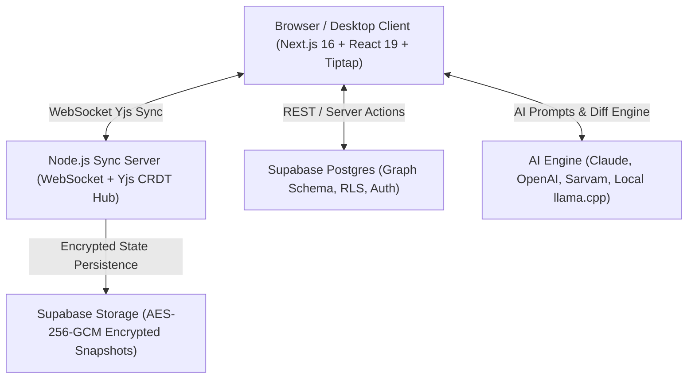

# Lekhan 🪶

<div align="center">

**The AI-native, collaborative knowledge workspace.**  
*Local-first like Obsidian. Collaborative like Notion. AI on your terms.*

[](https://nextjs.org/)
[](https://react.dev/)
[](https://yjs.dev/)
[](#-security--encryption)
[](LICENSE)

[Early Access Waitlist](https://lekhan.online/early) · [Report Bug](https://github.com/coderhd/lekhan/issues) · [Roadmap](#web-beta-and-roadmap)

</div>

---

## 🌟 What is Lekhan?

Lekhan is an open-source knowledge workspace for writing and organizing connected pages. Each workspace holds a graph of pages, links, tags, and properties. The editor, search, backlinks, and graph are different ways to work with that same content.

- **Write and navigate.** Create nested pages, link them with `[[wikilinks]]`, find them with global search, and follow backlinks.
- **Bring your work with you.** Import Markdown or an Obsidian vault, inspect the import report, and export your workspace as Markdown. The report identifies content that could not be imported faithfully.
- **Work offline and collaborate.** The web editor uses local browser storage and Yjs. The sync hub carries changes between connected collaborators. Shared pages have role-based access.
- **Choose how you use AI.** The provider registry supports user-managed keys and configurable providers. Availability depends on the deployment and provider setup.

### Web beta and roadmap

The web beta is gated on the first-use flow: **sign up → import → collaborate → export**. Workbench is the redesigned web interface and has its own acceptance checks. Join the [early access waitlist](https://lekhan.online/early) or see the [product roadmap](docs/roadmap.md) and [beta quality criteria](https://github.com/coderhd/lekhan/issues/79).

The next desktop milestone is a narrow macOS release for a local Markdown vault and collaboration. The bundled llama.cpp runtime and Model Library are deferred. See the [desktop storage decision](docs/adr/0003-desktop-markdown-plus-yjs-sidecar.md) for the design.

## 🏗️ Architecture



### Technology Stack
* **Framework**: [Next.js 16](https://nextjs.org/) (App Router, Turbopack) & [React 19](https://react.dev/)
* **Editor Substrate**: [Tiptap 2](https://tiptap.dev/) / [ProseMirror](https://prosemirror.net/) with custom decoration & node extensions
* **Collaboration & CRDTs**: [Yjs](https://yjs.dev/) + `y-prosemirror` + `y-websocket`
* **Styling & UI**: [Tailwind CSS](https://tailwindcss.com/), [Radix UI](https://www.radix-ui.com/), [Lucide Icons](https://lucide.dev/)
* **Backend & Database**: [Supabase](https://supabase.com/) (PostgreSQL with RLS, Auth, Storage)
* **Encryption**: Node.js `crypto` with `aes-256-gcm` envelope encryption
* **Testing**: [Vitest](https://vitest.dev/) (Unit & Integration) & [Playwright](https://playwright.dev/) (End-to-End)

---

## 📂 Project Structure

```text
├── app/                  # Next.js App Router (pages, layouts, API endpoints)
│   ├── api/              # API routes (/api/ai, /api/version, /api/import, /api/waitlist)
│   ├── doc/[id]/         # Legacy document route
│   ├── page/[id]/        # Pages knowledge graph workspace
│   └── early/            # Waitlist & early access landing
├── components/           # React UI components
│   ├── ui/               # Radix / Shadcn accessible UI primitives
│   ├── editor-workspace.tsx # Core collaborative Tiptap editor
│   ├── lekhan-bot-bar.tsx# In-editor AI assistant
│   └── global-search-palette.tsx # Cmd+K Search modal
├── docs/                 # Product specs, ADRs, runbooks, and roadmaps
│   ├── adr/              # Architecture Decision Records (ADR 0001 - 0004)
│   ├── reviews/          # Clean-room code review audit reports
│   └── roadmap.md        # Detailed internal product roadmap & issue tracking
├── lib/                  # Utilities, crypto engine, wikilink extension, analytics
│   ├── server-crypto.ts  # AES-256-GCM encryption & key rotation
│   ├── wikilink.ts       # Wikilink ProseMirror decoration extension
│   └── markdown-export.ts# Markdown & HTML serialization
├── scripts/              # Migration, backfill, and autonomous code review scripts
│   ├── review-pr.ts      # Clean-room multi-model AI code reviewer
│   └── encrypt-at-rest-backfill.ts # Encryption backfill utility
├── server/               # Collaborative Yjs WebSocket sync server
│   └── index.js          # Sync server with snapshot encryption
└── tests/                # Comprehensive test suite (Vitest + Playwright)
    └── unit/             # 54 test files (408+ automated tests)
```

---

## 💻 Getting Started

### Prerequisites
* **Node.js**: v20.0.0 or higher (v24 recommended)
* **npm** or **pnpm**
* A [Supabase](https://supabase.com) project

### Installation

1. **Clone the repository**:
   ```bash
   git clone https://github.com/coderhd/lekhan.git
   cd lekhan
   ```

2. **Install dependencies**:
   ```bash
   npm ci
   ```

3. **Configure Environment Variables**:
   Copy `.env.example` to `.env.local` and populate the required keys:
   ```bash
   cp .env.example .env.local
   ```
   ```env
   NEXT_PUBLIC_SUPABASE_URL=your_supabase_project_url
   NEXT_PUBLIC_SUPABASE_PUBLISHABLE_KEY=your_supabase_publishable_key
   SUPABASE_SERVICE_ROLE_KEY=your_supabase_service_role_key

   # Encryption at Rest (ADR 0001)
   LEKHAN_ENCRYPTION_KEY=your_32_byte_base64_or_hex_key

   # AI Integrations (Optional / BYOK)
   ANTHROPIC_API_KEY=your_claude_api_key
   OPENAI_API_KEY=your_openai_key
   SARVAM_API_KEY=your_sarvam_key
   ```

4. **Run the Development Server**:
   ```bash
   npm run dev
   ```
   Open [http://localhost:3000](http://localhost:3000) in your browser. For local collaboration testing, start the sync hub separately with `npm run server` after configuring its environment from `.env.example`.

---

## 🧪 Testing & Verification

**Manual QA:** Start with the [Web Beta QA Handoff](docs/qa/web-beta-manual-qa.md). It explains the product, test setup, priority scenarios, expected behavior, and how to report findings. Use the assigned QA build and synthetic test data.

For engineering context, see the [product roadmap](docs/roadmap.md) and the [hub persistence QA matrix](docs/qa/matrices/hub-page-persister-test-matrix.md).

Lekhan maintains a strict verification bar. No code lands without passing the full suite:

```bash
# Run type check
npm run typecheck

# Run linter
npm run lint

# Run Vitest unit and integration tests
npm test

# Build for production (Turbopack)
npm run build
```

---

## 🤝 Contributing

We welcome contributions from the community!

1. Fork the repository and create your feature branch: `git checkout -b feat/my-feature`.
2. Follow our commit convention: `feat(...)`, `fix(...)`, `docs(...)`, `refactor(...)`.
3. Ensure all tests pass (`npm test && npm run typecheck`).
4. Submit a Pull Request. Every PR is automatically audited by our clean-room peer review workflow.

---

## 📄 License

Lekhan is licensed under the **[GNU Affero General Public License v3.0 (AGPL-3.0)](LICENSE)** with an **MIT Open-Core Exception** for client libraries, UI themes, and community plugins:

* **Core Repository & Sync Hub**: Licensed under AGPL-3.0 to protect against proprietary SaaS cloning and ensure network-hosted modifications remain open.
* **Community Plugins & Client SDKs**: Permissively licensed under MIT to empower community developers to build and distribute extensions without friction.

---

<div align="center">
Built with passion by <b><a href="https://github.com/coderhd">Harsh Dave</a></b> and contributors.
</div>
